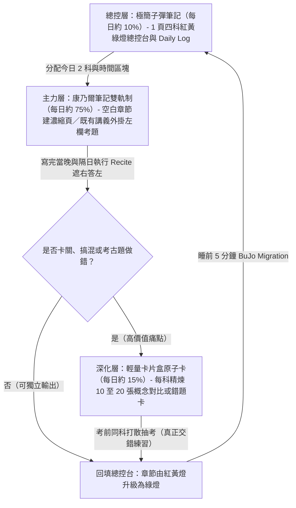

# 大二期末考兩週四科衝刺指南：三大筆記法深度比較與實作手冊

> **適用對象**：兩週（14 天）後面臨 4 科期末考的大二學生  
> **核心策略**：**極簡子彈筆記當總控台（~10%）＋ 康乃爾雙軌制當複習主力（~75%）＋ 輕量卡片盒收斂易錯與易混淆考點（~15%）**

---

## 核心結論速覽

當距離 4 科期末考只剩 14 天時，選擇筆記法的唯一指標是**「單位時間的考場得分轉換率（短期 ROI）」**，而不是追求完美的長期知識庫或美觀排版。三種筆記法在這個場景下各司其職，**合體使用遠勝單打獨鬥**：

1. **極簡子彈筆記法（Bullet Journal, BuJo）負責「控全局」**：砍掉繁瑣模組，只留 1 頁「14 天四科總控台」與每日極簡任務，解決四科進度打架與考前焦慮。
2. **康乃爾筆記法（Cornell Notes）負責「打主力」**：強制將單科講義轉化為「左欄考題／右欄解答／底部摘要」，把被動重讀變成高效率的遮蓋自測；若已有高品質講義，採**外掛左欄提問**不重抄。
3. **輕量卡片盒筆記法（Zettelkasten）負責「補弱點」**：**千萬別在考前 14 天從零學完整版卡片盒與新軟體**，而是只借用其「原子化＋連結對比」精神，為每科提煉 10–20 張「易混淆概念對比卡／經典錯題卡」。



---

## 1. 先看科學依據：為什麼考前兩週不能只靠單一筆記法？

在動筆整理任何筆記前，先對齊四項認知科學與教育心理學的研究結論，確保每一小時的努力都踩在「高回報區」：

### 1.1 高效學習策略與常見誤區（Dunlosky et al., 2013；Rohrer, 2012；Foster et al., 2019）
- **提取練習（Practice Testing，高效用）**：不看解答、主動從腦中把公式、演算法或論點「提取出來」，對記憶鞏固的增益遠勝重複閱讀。這正是康乃爾「遮右答左（Recite）」與計時寫考古題的核心原理。
- **分散練習（Distributed Practice，高效用）**：將同一科的複習拆散到多天進行（例如第 1、3、5、8 天各自複習一次 S1），長期保留率顯著高於考前一晚熬夜連讀 8 小時。
  - **關鍵觀念區分**：BuJo 安排「上午讀 A 科、下午讀 B 科」本質上屬於**跨科分散練習**與降低單科疲勞，**並非嚴格意義的交錯練習**；過短時段頻繁跨科切換反而會產生任務切換成本。
- **交錯練習（Interleaved Practice，中效用）**：依據**辨別對比假說（Discriminative-Contrast Hypothesis）**，交錯練習的獨特價值在於**「同一科目內部」混合不同題型或易混淆概念**（例如微積分混算不同積分技巧、資結打散各種圖論演算法），逼迫大腦練習「看題目辨識該選哪一招」。這正是考前用**打散的輕量原子卡抽考**與**混題刷考古題**的關鍵作用。
- **精緻化提問與自我解釋（中效用）**：強迫自己追問「為什麼這個條件成立」、「它跟另一個定理差在哪」，並用自己的話重新寫下，是卡片盒最擅長的事。
- **考前低效地雷（低效用）**：單純畫螢光筆、反覆重讀課本／PPT、逐字抄寫精美的摘要——這些動作會製造「看起來都很熟」的**熟悉感錯覺（Illusion of Competence）**，進考場一拿到空白考卷卻寫不出來。

### 1.2 制定具體計畫可立刻緩解焦慮（Masicampo & Baumeister, 2011）
四科期末考同時逼近時，腦中常反覆冒出「這科還沒念完、那科會不會被當」的侵入性思緒（蔡格尼克效應），持續佔用寶貴的工作記憶。Masicampo & Baumeister（2011）的研究指出，**只要為未完成目標制定具體的執行計畫，就能有效終止侵入性思緒、釋放認知資源**——這也是為什麼考前第一天先花半小時寫「極簡子彈筆記總控台」能讓人立刻定下心來。

### 1.3 既有講義與題型深度的邊界（Jacobs, 2008）
Jacobs（2008）比較康乃爾筆記與引導式筆記（Guided Notes）後發現：在單純記憶事實的基礎題上，引導式筆記因認知負荷低而不輸康乃爾；**康乃爾的顯著優勢主要體現在需要分析、綜合與應用的中高階題型**。換言之，若教授給的投影片或講義本身已經極具結構，考前切勿再整份抄寫成康乃爾右欄，而應直接**在原講義旁「外掛左欄考題與頁尾摘要」**，把時間省下來做提取練習。

### 1.4 手寫 vs. 筆電／平板的務實結論（Mueller & Oppenheimer, 2014；Urry et al., 2021）
早期 Mueller & Oppenheimer（2014）曾指出手寫優於筆電，但 Urry et al.（2021）的大型直接重複實驗顯示，打字組在測驗表現上並無穩定的顯著劣勢；真正拉開分數差距的不是「紙筆還是 iPad」，而是**是否落入「逐字抄寫（verbatim copying）」**。  
因此考前 14 天的鐵則是：**絕對不要臨時更換新軟體或新設備**，沿用你目前最順手的紙本、平板或筆電，並強制自己「用自己的話轉譯＋遮蓋自測」。

> **實證強度誠實說明**：康乃爾筆記法有多項直接針對課堂學習與測驗的準實驗實證支持（如 Faber et al., 2000；Jacobs, 2008）；而卡片盒筆記法（源自社會學研究案例）與子彈筆記法（源自個人設計實務）目前在教育心理學界**仍缺乏直接針對短期大學考試分數的隨機對照試驗（RCT）**，兩者的考前價值是建立在上述底層認知機制的組合推論之上。

---

## 2. 三種筆記法深度解析（優缺點、學習門檻與 14 天改法）

### 2.1 三種筆記法橫向總比較表

| 比較維度 | 卡片盒筆記法（Zettelkasten） | 康乃爾筆記法（Cornell Notes） | 子彈筆記法（Bullet Journal / BuJo） |
| :--- | :--- | :--- | :--- |
| **本質定位** | 網狀知識生產與長期思考系統 | 單科線性吸收與主動回想工具 | 任務、進度與注意力管理系統（非知識筆記） |
| **起源與依據** | Niklas Luhmann（德國社會學家，累積約 90,000 張紙卡：ZK I 約 2.2–2.3 萬張、ZK II 約 6.6–6.7 萬張，產出約 70 本專書與 400+ 篇論文）；Sönke Ahrens（2017）系統化詮釋 | Dr. Walter Pauk（1950s 康乃爾大學研發，1962 年《How to Study in College》公開發表） | Ryder Carroll（1990s 末起研發，2013 年公開網站、2018 年出版專書） |
| **核心機制** | 原子化（一卡一概念）＋自己話轉譯＋由下而上雙向／分支連結（編號或 `[[連結]]`） | 三區版面（右 70% 主欄／左 25–30% 線索提問／底 5–7 行摘要）＋ **5Rs 與 Recapitulate** | Rapid Logging 符號（`•` / `X` / `>` / `<` / `○` / `–`）＋ Collections ＋ 每日 Migration |
| **學習門檻（綜合）** | **高（★★★★☆）**<br>• 規則上手：1–2 週<br>• 思維轉換（樹狀→網狀）：難<br>• 摩擦點：切分粒度、三階儀式與軟體外掛 | **低（★★☆☆☆）**<br>• 版面上手：5 分鐘<br>• 思維轉換：低<br>• 摩擦點：把左欄從「小標題」升級為「高擬真考題」 | **低～中低（★★☆☆☆）**<br>• 符號上手：10 分鐘<br>• 習慣建立：2–3 天<br>• 摩擦點：克制排版美化、維持每日 5 分鐘結算 |
| **實證基礎性質** | 歷史高產案例＋底層認知機制推論（自我解釋、精緻化提問）；缺短期考試 RCT | 具直接教育準實驗支持，中高階理解／應用題增益最明顯 | 計畫減焦慮與認知卸載機制支持（Masicampo & Baumeister, 2011）；缺直接成績 RCT |
| **14 天考前短期 ROI** | **完整系統：極低（冷啟動地雷）**<br>**輕量借用（錯題／對比卡）：中高** | **極高（兩週衝刺主力引擎）** | **極高（控管四科不翻車的總指揮台）** |
| **長期學業複利** | **極高**（大二一路累積至大四專題與考研） | **中**（偏向單科單學期複習與查閱） | **高**（建立長期時間與專案管理習慣） |
| **考前最大失敗陷阱** | 考前沉迷研究 Obsidian／Notion 外掛，或執著把整本課本走完三階轉錄儀式 | 只抄右欄投影片不做遮蔽自測；或已有好講義卻整份重抄浪費時間 | 陷入畫邊框、貼紙膠帶的美化陷阱，或建齊全套四大模組卻沒時間念書 |
| **14 天極簡落地改法** | **跳過三階儀式與新軟體**；每科只挑最易混淆概念與錯題做 10–20 張「原子對比／錯題卡」 | **雙軌制**：空白章節建 1 章 1–2 頁濃縮版；已有詳盡講義者**直接外掛左欄提問＋頁底摘要** | **大砍模組**：刪掉 Future/Monthly Log 與正式 Index，只留「1 頁四科總控台＋極簡 Daily Log」 |
| **適用大二科目** | 理論整合、跨章比較與申論型科目 | 幾乎全科通吃（計算、系統、記憶、理論皆宜） | 作為**跨 4 科總控層**（協調考期衝突與覆蓋率） |

---

### 2.2 卡片盒筆記法（Zettelkasten）深度拆解

#### 核心原理與正名
卡片盒由德國社會學家 Niklas Luhmann 發揚光大，透過每張卡片只寫一個獨立概念（原子化）、用自己的話改寫、並讓卡片彼此建立關聯，長出能產生洞見的知識網絡。  
需要特別釐清的是：**許多教學常講的「閃念筆記 → 文獻筆記 → 永久筆記」三階管線，其實是 Sönke Ahrens（2017）《How to Take Smart Notes》的現代教學詮釋，並非 Luhmann 原生術語**。在實務上，這套三階轉錄儀式容易帶來沉重的「行政摩擦（Administrative Friction）」——平常學期初這樣做很有複利，但考前兩週照搬必翻車。

- **優點（Pros）**：
  - 強迫「用自己的話解釋」，能徹底揪出自己「以為懂了、其實講不出來」的假性理解。
  - 透過概念間的對比連結（例如 A 定理和 B 定理差在哪一個前提），極度擅長應付期末考愛考的**綜合比較題與跨章申論題**。
  - 知識以獨立小卡片存在，非常適合**打散抽考**，完美落實同科交錯練習。
- **缺點與考前地雷（Cons）**：
  - **學習曲線陡峭**：光是決定「這段話要切幾張卡」、「標籤和連結怎麼命名」就能耗掉大量時間，缺乏考試進度感（會焦慮整章還沒看完）。
  - **工具沉迷風險極高**：若考前才下載 Obsidian／Logseq 學雙向連結與外掛，幾乎一定會把時間花在調設定而不是念書。
- **學習門檻拆解（高 ★★★★☆）**：語法不難，難在**思維從「按章節目錄樹狀收納」轉為「按問題與關聯網狀連結」**，正常需 1–2 週適應期。
- **考前 14 天輕量用法**：**忘掉三階儀式與新軟體！** 直接用紙卡（A6 小卡或對折 A4 紙）或現成電子筆記本，每科只為「**一直搞混的概念**」和「**寫錯的考古題**」各建 10–20 張「原子對比／錯題卡」。

---

### 2.3 康乃爾筆記法（Cornell Notes）深度拆解

#### 核心原理與標準 6Rs
由康乃爾大學教育學教授 Walter Pauk 設計，將單頁劃分為三區：**右側主欄（約 70%）**記錄核心內容、**左側線索欄（約 25–30%）**寫提問與關鍵線索、**底部摘要欄（5–7 行）**寫整頁總結。  
其真正發揮威力靠的是 **5Rs 流程＋第 6R 摘要收斂**：
1. **Record（記錄）**：在右欄記下核心定義、推導關鍵步驟或因果邏輯（非逐字抄寫）。
2. **Reduce / Question（簡化／提問）**：讀完該段落後，立刻在左欄寫下「能考倒自己的問題或關鍵字線索」。
3. **Recite（背誦／自測）**：**遮住右欄**，只看左欄問題嘗試口頭說出或默寫出完整答案（最高效用提取練習）。
4. **Reflect（反思連結）**：思考這頁跟前面章節、現實案例或常見變形題的關聯。
5. **Review（週期複習）**：每週固定抽 15–20 分鐘快速遮蓋複習舊頁，避免遺忘。
6. **Recapitulate / Recap（底部摘要）**：依康乃爾學習策略中心（LSC）標準架構，於頁底用自己的話濃縮整頁主旨。*(註：考前衝刺時，可額外加上「考古題反饋」——把寫錯的考點直接補進對應頁面的左欄問題中，作為考前高階修訂動作。)*

- **優點（Pros）**：
  - **結構天然對應「考卷邏輯」**：左欄是題目、右欄是標準答案，只要用手或紙遮住右欄，筆記本立刻變成個人客製化題庫。
  - **幾乎零學習成本**：5 分鐘就能畫出三區版面，心理阻力極低，當天就能看見一章一章完成的進度感。
  - **特別強化中高階題型**（Jacobs, 2008）：強迫提問與濃縮摘要能大幅提升理解與應用表現。
- **缺點與考前地雷（Cons）**：
  - **左欄無效化**：多數學生把左欄寫成「1.1 定義」、「範例二」這種目錄小標題，遮住右欄後根本不知道要回答什麼，瞬間失去提取練習功能。
  - **重抄時間黑洞**：如果教授已經發了 80 頁詳細 PPT 或講義，還把右欄全部重抄一遍，14 天內絕對念不完 4 科。
- **學習門檻拆解（低 ★★☆☆☆）**：版面極簡單；唯一需要刻意練習的是**把左欄寫成「不看右欄也能作答的具體考題」**。
- **考前 14 天雙軌用法**：
  - **軌道 1（無筆記／空白章節）**：建「1 章 1–2 頁」高度濃縮版康乃爾筆記，右欄只留框架、公式條件與關鍵圖表。
  - **軌道 2（已有詳盡講義／PPT）**：**絕不重抄右欄！** 直接把原講義當作右欄（在紙本空白邊緣／便利貼，或 PDF／GoodNotes／OneNote 側邊）加上「左欄考題」與「該單元最後一頁的底部摘要」。

---

### 2.4 子彈筆記法（Bullet Journal / BuJo）深度拆解

#### 核心原理與符號方向
由設計師 Ryder Carroll 發明的極簡個人管理系統，它**不是用來寫學科知識的筆記，而是用來管理「任務、時間與注意力」的作業系統**。
- **Rapid Logging（快速紀錄符號）**：
  - `•` 待辦任務（Task）
  - `X` 已完成任務（Completed）
  - `>` **遷移／前移（Migrated）**：今天沒做完，**往後推**到明天、下週或特定 Collection（例如四科總控表）
  - `<` **排程／回排（Scheduled）**：需要延後到更遠未來的事項，**往回寫進**本子前段的 Future Log
  - `○` 行程／事件（Event，如「12/09 10:10 線代期末考」）
  - `–` 簡短筆記／狀態備忘（Note）
- **核心價值**：透過每天睡前 5 分鐘的 **Migration（遷移檢視）**，強迫你誠實面對「哪些任務一再被 `>` 拖延」，並透過對未來 14 天制定具體排程，止住焦慮（Masicampo & Baumeister, 2011）。

- **優點（Pros）**：
  - 完美解決大二生「4 科同時壓過來，不知道今天該先救哪一科」的癱瘓感。
  - 能一眼看穿各科章節覆蓋率（紅／黃／綠燈），避免某科念太爽、另一科完全開天窗。
  - 工具自由度高，一張 A4 折疊紙、筆記本或純文字 Markdown 清單都能立刻啟動。
- **缺點與考前地雷（Cons）**：
  - **不能直接替代讀書本身**：寫完總控表不代表知識進到腦袋裡。
  - **IG 手帳美化陷阱**：花 2 小時畫跨頁月曆、貼紙與花體字，是考前最常見的「生產力拖延」。
  - **照搬完整四大模組過於笨重**：在只有 14 天的短衝刺期，傳統的 Future Log、Monthly Log 與正式 Index 幾乎沒有發揮空間。
- **學習門檻拆解（低～中低 ★★☆☆☆）**：符號 10 分鐘即學會；真正門檻在於克制過度設計，並養成睡前 5 分鐘結算的紀律。
- **考前 14 天極簡砍模組版**：**直接砍掉 Future Log、Monthly Log 與正式 Index！** 整個考前系統只保留兩樣東西：**1 頁「14 天四科紅黃綠燈總控台」＋ 每天「不超過 3 件主力任務的極簡 Daily Log」**（搭配本資料夾 [notes/ch1.md](./notes/ch1.md) 提到的每日關鍵任務與時間區塊概念）。

---

## 3. 適用科目與考試形式雙維適配指南

### 3.1 大二常見四大科目原型配比表

請將你的 4 門期末考科目分別對照以下四種原型，決定筆記主力：

| 科目原型 | 代表大二科目 | 主力與輔助配比 | 考前複習核心操作重點 |
| :--- | :--- | :--- | :--- |
| **A. 計算與推導型** | 微積分、線性代數、工程數學、機率統計、工程力學 | **康乃爾雙軌制（80%）**<br>＋ 輕量錯題／條件對比卡（10%）<br>＋ 極簡 BuJo（10%） | 右欄不抄完整四則運算，改寫**「適用前提 → 核心公式 → 關鍵變形第一步」**；左欄寫「看到何種題型特徵該用此法」。錯題卡專門記錄「條件漏檢查（如矩陣是否可逆）」的陷阱。 |
| **B. 程式與系統型** | 資料結構與演算法、作業系統、計算機組織、Python／C++ 實作 | **康乃爾雙軌制（75%）**<br>＋ 輕量選型對比卡（15%）<br>＋ 極簡 BuJo（10%） | 右欄畫**狀態轉換圖、記憶體／指標示意圖與時間空間複雜度**；左欄寫「情境題／Edge Case」與「若改為某限制會怎樣」。對比卡專治演算法選型與 OS 排程／同步機制混淆。 |
| **C. 記憶與定義型** | 會計學、生物化學、生理學、法條／商法、專業名詞 | **康乃爾遮蔽自測（80%）**<br>＋ 易混比較卡（10%）<br>＋ 極簡 BuJo（10%） | 左欄強制設計「給英文名詞默寫定義＋舉 1 個反例」或「相似名詞差異比較」；**Recite 遮蔽次數是這類科目的勝負關鍵**，切忌盯著畫滿螢光筆的課本默念。 |
| **D. 理論與申論型** | 經濟學、管理學、心理學、社會學、法理學、設計理論 | **康乃爾結構化（65%）**<br>＋ 輕量概念網狀卡（25%）<br>＋ 極簡 BuJo（10%） | 卡片盒比例可略微拉高！用原子卡串聯「理論 A（假設／結論）↔ 理論 B（修正／反駁）」，並用康乃爾左欄練習**「30 秒列出申論題三段式答題骨架」**。 |

### 3.2 考試形式適配矩陣（Exam Format Matrix）

即使同屬計算或理論科，不同教授的考制也會大幅改變筆記寫法：

| 考試形式 | 康乃爾筆記調整重點 | 輕量卡片盒調整重點 | 極簡子彈筆記重點 |
| :--- | :--- | :--- | :--- |
| **閉卷筆試（Closed-Book，主流）** | 左欄大量設計「無提示默寫／推導觸發題」，全力強化 **Recite 遮蔽自測**。 | 專攻「易混淆對比卡」與「經典錯題卡」，考前 48 小時打散混抽（真正交錯練習）。 | 嚴格追蹤每章 `🔴→🟡→🟢` 燈號與間隔複習日次。 |
| **開書考 / 帶 A4 大抄（Open-Book / Cheat Sheet）** | **降低死背比例**！右欄改整理「條件 → 公式／法條決策樹」，底欄明確標註**課本對應頁碼索引**。 | 將跨章節綜合判準濃縮為「一頁式決策對照卡」，直接作為 A4 大抄的排版骨架。 | 預留 Day 11–12 專門實測「計時寫考古題＋翻書查表速度」。 |
| **上機程式考 / 實作題（Coding / Lab）** | 左欄寫「題型辨識特徵與邊界測資（Edge Cases）」，右欄寫「核心虛擬碼思路與複雜度」，**不手抄完整程式碼**。 | 建立「常見 Bug 與演算法選型對比卡」（例如 BFS vs DFS、DP 狀態定義陷阱）。 | 在總控台追蹤必寫題庫清單，記錄「真正於 IDE 跑過（AC）」而非只用眼睛看過的題數。 |

---

## 4. 兩週（Day 1–Day 14）四科期末考實作建議表

### 4.1 啟動前設定規則
1. **科目優先級分級（Day 1 決定）**：依「考試日期先後 × 學分／難度 × 目前掌握度」，將四科標記為：
   - **S1**：最急（最早考或最容易被當的救命科）
   - **S2**：最硬（範圍最大、權重高或需大量推導練習）
   - **S3**：中等（按部就班即可穩過）
   - **S4**：緩衝（最晚考，或平時已有基礎相對穩固）
2. **雙軌每日時間配額**：
   - **停課衝刺版（每日 6–7 小時）**：採三大時間區塊——上午 2.5h 攻硬科、下午 2.5h 攻第二科、晚間 1.5–2h 專做「遮蓋自測＋原子卡＋睡前 5 分鐘 BuJo」。
   - **課滿緊湊版（平日仍有正課／實驗／報告，每日 3.5–4 小時）**：嚴格執行 **80/20 法則**，全面優先使用「原講義外掛左欄提問」，果斷放棄低配分冷門章節。
3. **執行節奏與恢復保護**：建議在每個工作區塊內搭配番茄鐘單工專注（25 分鐘專注＋5 分鐘休息，降低訊息通知干擾），並維持固定睡眠時間保護記憶鞏固——這與本資料夾中的 [notes/ch2.md](./notes/ch2.md)（專注力單工）與 [notes/ch3.md](./notes/ch3.md)（睡眠與記憶整理）原則完全一致。
4. **兩個內建緩衝檢核點**：刻意保留 **Day 7 下午**與 **Day 11 下午**作為不排新進度的緩衝時段，防止前幾天因臨時報告或某科卡關導致計畫全盤崩潰。

### 4.2 Day 1–Day 14 逐日實作建議表

| 天數 | 階段 | 主攻科目排程（跨科分散） | 核心實作動作（三法分工） | 每日明確產出 KPI | 緊湊版（3.5–4h）精簡調整 |
| :--- | :--- | :--- | :--- | :--- | :--- |
| **Day 1** | **P1 盤點與啟動** | 全 4 科盤點 ＋ **S1** | **BuJo（限時 ≤ 60 分鐘）**：畫 1 頁「14 天四科總控台＋章節紅黃綠燈表」，確認各科考制與配分。<br>**康乃爾**：啟動 S1 最重要 1–2 章。 | 完成 4 科盤點與 S1–S4 分級；S1 完成 1–2 章考前康乃爾筆記。 | 總控台限時 30 分鐘；S1 直接在既有講義外掛左欄考題。 |
| **Day 2** | **P1 盤點與啟動** | **S2** ＋ **S1** | **康乃爾**：推進 S2 前段高權重章節；晚間進行 Day 1 的 S1 頁「首次遮右答左（Recite）」。<br>**BuJo**：睡前 5 分鐘完成首次 Migration。 | S2 完成 2 章康乃爾頁；S1 完成第 1 次隔日提取自測。 | 只做 S2 高頻必考例題章節，不抄寫繁瑣證明全文。 |
| **Day 3** | **P2 第一輪主幹輸出** | **S1** ＋ **S3** | **康乃爾（主力）**：推進 S1 中段與 S3 前段章節（依講義品質採新建／外掛雙軌）。<br>**輕量卡片盒**：針對前兩天易混淆點試寫 2–3 張對比卡。 | S1 累計進度 ≥ 50%；S3 啟動完成 2 章；產出首批原子卡。 | S1、S3 各保底完成 1 個高權重核心章節＋左欄提問。 |
| **Day 4** | **P2 第一輪主幹輸出** | **S2** ＋ **S4** | **康乃爾**：推進 S2 中段與 S4 前段；晚間 30 分鐘快刷自測 Day 2–3 頁。<br>**BuJo**：將完成整理與首次自測的章節由 🔴 改標為 🟡。 | S2 累計進度 ≥ 50%；S4 啟動完成 2 章；紅燈開始減少。 | S4 若最晚考或最穩，先完成核心章節大綱外掛提問。 |
| **Day 5** | **P2 第一輪主幹輸出** | **S1** ＋ **S3** | **康乃爾**：收尾 S1 剩餘章節，推進 S3 中後段。<br>**輕量卡片盒**：替 S1 提煉 4–5 張跨章概念對比或公式邊界卡。 | **S1 第一輪範圍 100% 完稿**（消滅所有 🔴）；S3 ≥ 60%。 | S1 確保佔 80% 配分的主幹章節完稿，冷門小節先標記略過。 |
| **Day 6** | **P2 第一輪主幹輸出** | **S2** ＋ **S4** | **康乃爾**：收尾 S2 剩餘章節，推進 S4 中後段。<br>**輕量卡片盒**：替 S2 提煉 4–5 張關鍵對比／常錯陷阱卡。 | **S2 第一輪範圍 100% 完稿**；S4 ≥ 60%。 | 同上，優先保住 S2 必考題型與高頻章節。 |
| **Day 7** | **P2 收尾 ＋ 緩衝日①** | **S3** ＋ **S4** ＋ **緩衝補洞** | **上午**：完成 S3、S4 剩餘核心章節。<br>**下午（緩衝檢核點①）**：不排新進度！專補 Day 1–6 落後頁、把四科所有頁底摘要補齊。<br>**BuJo**：中盤檢討並微調第 2 週各科配比。 | 四科核心範圍 85%–100% 轉化為可自測康乃爾筆記；完成中盤進度校準。 | 若平日落後較多，Day 7 全天作為補洞＋整理 S3/S4 主幹。 |
| **Day 8** | **P3 主動提取與實戰** | **S1** ＋ **S2**（考古題首輪） | **康乃爾（純 Recite）**：不重讀右欄，直接遮蓋自測 S1 全範圍左欄，卡關題畫紅星 ★。<br>**實戰**：計時寫 S1、S2 各 1 份考古題／習題。<br>**輕量卡片盒**：所有錯題立刻轉為「錯題原子卡」。 | 完成 S1、S2 首輪考古題實戰；每科累計 8–12 張原子卡。 | 考古題先做近 2 年核心大題，錯題立刻進原子卡。 |
| **Day 9** | **P3 主動提取與實戰** | **S3** ＋ **S4**（考古題首輪） | **康乃爾（純 Recite）**：遮蓋自測 S3、S4 左欄並標記紅星 ★。<br>**實戰**：計時寫 S3、S4 各 1 份考古題。<br>**BuJo**：於總控台開啟「四科紅星考點清零計數」。 | 四科全部完成至少 1 輪主動提取＋1 份考古題實戰。 | 若 S4 考期在考週最後幾天，可將其時間讓渡 30% 給 S1/S2。 |
| **Day 10** | **P3 同科交錯刷題** | **S1** ＋ **S3**（二輪深化） | **真正交錯練習**：將 S1、S3 跨章題目與原子卡**同科內部打散抽考**，訓練「看題選招」；寫第 2 份考古題或申論提綱。<br>**康乃爾**：將考古題新發現考點補回左欄。 | S1、S3 紅星考點消滅 ≥ 60%；每科原子卡收斂定稿（12–20 張）。 | 專做「打散抽考紅星左欄＋錯題原子卡重算」，免寫全卷。 |
| **Day 11** | **P3 二輪深化 ＋ 緩衝日②** | **S2** ＋ **S4** ＋ **緩衝補洞** | **上午**：S2、S4 同科打散混合抽考＋第 2 份考古題（若為 Open-book 科，同步定稿 A4 大抄與頁碼索引）。<br>**下午（緩衝檢核點②）**：集中爆破四科最頑固的 3 個紅燈單元。<br>**BuJo**：鎖定最後 72 小時考序衝刺表。 | 四科完成第二輪提取與錯題收斂；Open-book 科完成大抄定稿。 | 下午集中處理最危急 2 科的紅星考點，果斷放掉 CP 值極低偏題。 |
| **Day 12** | **P4 精準收斂（停寫長筆記）** | **依考序前傾（例 S1 60% / S2 40%）** | **鐵則：停止製作任何新長筆記！** 全天只反覆刷三樣高密度產出：(1) 康乃爾紅星左欄、(2) 頁底摘要、(3) 輕量原子卡打散抽考。 | S1、S2 紅星考點歸零或完成 80/20 取捨；答題反應流暢。 | 全程只看「紅星左欄＋錯題原子卡」，大幅縮減無效閱讀時間。 |
| **Day 13** | **P4 精準收斂** | **依考序（例 S1 40% / S2 40% / S3–S4 20%）** | 全真模擬計時演練 S1、S2 最弱題型；晚間快速翻閱 S3、S4 原子卡維持記憶熱度（避免完全放冷）。<br>**BuJo**：列出考場裝備清單（工程計算機、學生證、大抄、文具）。 | S1、S2 進入「看到題幹即反射解法」狀態；考場物品就緒。 | 確保 S1 達標，S3/S4 僅做 20 分鐘卡片快刷保溫。 |
| **Day 14** | **P4 考前 24 小時定心** | **明日首戰科目（S1 為主）** | 白天最後 2 輪快刷 S1 原子卡與康乃爾底欄摘要；**傍晚後停止啃新範圍**。<br>**睡眠保護**：睡前 1 小時遠離螢幕、確保 **7–8 小時充足睡眠**讓大腦完成記憶鞏固。 | 心態穩定、零熬夜，滿電迎接 Day 15 首戰。 | 嚴守不熬夜原則，睡前僅花 15 分鐘輕刷 S1 關鍵對比卡。 |

> **考週分散彈性規則**：若你的 4 科並非連兩天考完，而是分散在考週的第 15–19 天，Day 12–14 可將 **70% 以上時間重押在前兩科（S1、S2）**；待考完前兩科後，再利用考週中間空檔，以完全相同的「紅星左欄＋原子卡抽考」節奏收斂 S3 與 S4。

---

## 5. 開箱即用實戰模板與避坑檢核表

### 5.1 3 分鐘「四科對號入座」設定卡（Day 1 填寫）

```text
【我的 14 天四科對號入座卡】
1. 優先級 S1（最急／救命科）：__________ ｜ 考期：__/__ ｜ 考制：□閉卷 □開書 □上機 ｜ 原型：□A □B □C □D
2. 優先級 S2（最硬／高權重）：__________ ｜ 考期：__/__ ｜ 考制：□閉卷 □開書 □上機 ｜ 原型：□A □B □C □D
3. 優先級 S3（中等穩健推進）：__________ ｜ 考期：__/__ ｜ 考制：□閉卷 □開書 □上機 ｜ 原型：□A □B □C □D
4. 優先級 S4（最晚考／最穩）：__________ ｜ 考期：__/__ ｜ 考制：□閉卷 □開書 □上機 ｜ 原型：□A □B □C □D
※ 本人可用時數模式：□ 課滿緊湊版（3.5–4h/日）  □ 停課衝刺版（6–7h/日）
※ 本人固定筆記媒介（14 天不更換）：_______________________
```

### 5.2 模板 A：極簡子彈筆記「14 天四科總控台＋Daily Log」

直接抄在筆記本最前面第 1 頁即可，**不需要**畫月曆或目錄頁：

```markdown
## 14 天四科紅黃綠燈總控台
燈號定義：🔴 尚未整理 ｜ 🟡 已建康乃爾左欄待刷題 ｜ 🟢 遮蓋自測＋考古題通過

| 科目 | 考期 | Ch1 | Ch2 | Ch3 | Ch4 | Ch5 | Ch6 | 考古題 | 原子卡進度 |
| :--- | :--- | :-: | :-: | :-: | :-: | :-: | :-: | :---: | :--- |
| S1 線性代數 | 12/09 | 🟢 | 🟢 | 🟡 | 🟡 | 🔴 | 🔴 | 1 / 3 份 | 8 / 15 張 |
| S2 資料結構 | 12/10 | 🟢 | 🟡 | 🟡 | 🔴 | 🔴 | - | 0 / 3 份 | 4 / 15 張 |
| S3 經濟學   | 12/11 | 🟡 | 🔴 | 🔴 | 🔴 | 🔴 | 🔴 | 0 / 2 份 | 2 / 15 張 |
| S4 通識/選修 | 12/12 | 🟡 | 🔴 | 🔴 | - | - | - | 0 / 2 份 | 0 / 10 張 |

## Daily Log（極簡日誌範例）
### Day 3（今日主力：S1 線代 ＋ S3 經濟）
• [S1] 完成 Ch3 特徵值講義外掛左欄提問＋頁底摘要  →  X（已完成）
• [S3] 完成 Ch2 供需彈性康乃爾濃縮頁               →  X（已完成）
• [晚間] 遮蓋自測 S1 Ch1–2 ＋ 寫 3 張錯題原子卡     →  >（剩 1 張移至 Day 4）
– 備註：發現線代「可對角化 vs 正交對角化」條件常搞混，明天優先補一張對比卡！
```

### 5.3 模板 B：康乃爾考前雙軌範本（以大二「線性代數」為例）

> **關鍵差異示範**：左欄千萬不要寫「`4.1 特徵值定義`」（遮住右欄你不知道該答什麼），而要寫成「**具體可考倒自己的問題**」。

```markdown
================================================================================
科目：線性代數 ｜ 章節：Ch.5 特徵值與對角化（或標註：外掛於教授講義 p.42–55）
================================================================================
【左欄：考題／線索 (25–30%)】      | 【右欄：核心推導／架構解答 (70%)】
                                     |
Q1. 判斷 n×n 矩陣 A 能否「對角化」   | 1. 充要條件：A 擁有 n 個線性獨立的特徵向量
    的充要條件？與「可逆」有關係嗎？ |    （每個特徵值的幾何重數 = 代數重數）。
    ★（考古題常考觀念陷阱）          | 2. 與可逆無關！A 不可逆（λ=0）仍可能對角化；
                                     |    反之 A 可逆也不保證能對角化（如剪切矩陣）。
                                     |
Q2. 對稱矩陣（A = A^T）多出哪三個    | (1) 所有特徵值皆為實數。
    超強性質？何時可「正交對角化」？ | (2) 不同特徵值對應的特徵向量必彼此正交。
                                     | (3) 實對稱矩陣「保證」可正交對角化（P 為正交矩陣）。
--------------------------------------------------------------------------------
【底部：Recapitulate 整頁濃縮摘要（3–5 句話）】
對角化看的是「特徵向量夠不夠多（線性獨立）」，跟特徵值是不是 0（可不可逆）無關；
一旦矩陣是實對稱矩陣，直接升級為必可正交對角化，且 P^{-1} 直接等於 P^T，計算快非常多。
================================================================================
```
*既有講義外掛法操作提示*：若教授已發詳細講義，右欄直接就是講義本身；左欄請改寫在**講義左側空白處、長條便利貼，或平板閱讀器的側邊空白畫布**，底部摘要則寫在該單元最後一頁下方。

### 5.4 模板 C：輕量卡片盒「原子對比／錯題卡」（以大二「資料結構」為例）

不需編號與軟體外掛，直接採用統一的 **4 欄迷你卡片格式**：

```markdown
【卡名】BFS vs. DFS 選型與複雜度對比（資料結構）
- **一句話本質**：BFS 用 Queue 逐層擴張（保最短無權路徑）；DFS 用 Stack/遞迴深探到底（探連通／環／拓撲）。
- **對比連結**：↔ 常與 `Dijkstra（帶正權最短路徑）` 及 `拓撲排序（Kahn's BFS vs DFS 後序反轉）` 一起考選型。
- **考場常設陷阱**：
  1. 題目只要「邊有權重」，用 BFS 求最短路徑一定錯！
  2. 問「Space Complexity（空間複雜度）」時，寬而淺的圖 DFS 省記憶體；細而深的圖（如長鏈）DFS 可能 Stack Overflow，反而是 BFS 穩。
```

*(補充範例 — 理論申論科「經濟學」)*：  
- **【卡名】「需求量變動」vs.「需求變動」**  
  - **一句話本質**：前者是「本身價格改變」造成的**點沿線移動**；後者是「價格以外因素（所得、偏好、替代品價）」造成的**整條線移動**。  
  - **對比連結**：↔ 連結 `價格彈性` 與 `供給曲線移動分析`。  
  - **考場常設陷阱**：申論題題幹寫「因咖啡豆漲價導致星巴克調整售價，影響消費者購買杯數」，畫圖時千萬別誤把需求線往左移！

---

### 5.5 考前 14 天五大反模式避坑檢核表

在衝刺期間每 3 天檢查一次以下五條底線，只要全數維持打勾，就不會掉進低效忙碌陷阱：

- [ ] **不臨時換新工具**：絕不在考前兩週從零學 Obsidian、Notion 資料庫或新平板 App，沿用最順手工具。
- [ ] **不重抄高品質講義**：教授已給清楚 PPT／講義時，只「外掛左欄考題＋頁底摘要」，不浪費時間重抄右欄。
- [ ] **不把跨科排程當交錯練習**：理解跨科切換是「分散練習」；真正練題時會在**同科內部打散題型／原子卡**混抽。
- [ ] **不美化子彈筆記手帳**：BuJo 每日維護不超過 5 分鐘，不畫裝飾邊框、不建 Future Log 與多餘頁面。
- [ ] **最後 72 小時停寫新長筆記＋嚴守睡眠底線**：Day 12 起只刷紅星左欄與原子卡；Day 14 絕不熬夜通宵，確保睡眠鞏固記憶。

---

## 6. 參考文獻與理論來源

1. **Dunlosky, J., Rawson, K. A., Marsh, E. J., Nathan, M. J., & Willingham, D. T. (2013).** Improving students' learning with effective learning techniques: Promising directions from cognitive and educational psychology. *Psychological Science in the Public Interest*, 14(1), 4–58.
2. **Rohrer, D. (2012).** Interleaving helps students distinguish among similar concepts. *Educational Psychology Review*, 24(3), 355–367.
3. **Foster, N. L., Mueller, M. L., Was, C., Rawson, K. A., & Dunlosky, J. (2019).** Why does interleaving improve math learning? The contributions of discriminative contrast and distributed practice. *Memory & Cognition*, 47(6), 1088–1101.
4. **Masicampo, E. J., & Baumeister, R. F. (2011).** Consider it done! Plan making can eliminate the cognitive effects of unfulfilled goals. *Journal of Personality and Social Psychology*, 101(4), 667–683.
5. **Jacobs, K. (2008).** *A comparison of two note taking methods in a secondary English classroom* (Master's thesis, Wichita State University). / 亦參見 **Faber, J. E., Morris, J. D., & Lieberman, M. G. (2000).** The effect of note taking on ninth grade students' comprehension. *Reading Psychology*, 21(3), 257–270.
6. **Mueller, P. A., & Oppenheimer, D. M. (2014).** The pen is mightier than the keyboard: Advantages of longhand over laptop note taking. *Psychological Science*, 25(6), 1159–1168.
7. **Urry, H. L., Crittle, C. S., Floerke, V. A., et al. (2021).** Don't ditch the laptop just yet: A direct replication of Mueller and Oppenheimer's (2014) Study 1 plus mini meta-analyses across similar studies. *Psychological Science*, 32(3), 326–339.
8. **Pauk, W. (1962 / subsequent eds.).** *How to Study in College*. Boston: Houghton Mifflin.（康乃爾筆記法與 5Rs/6Rs 架構原典；另參 Cornell University Learning Strategies Center）
9. **Ahrens, S. (2017).** *How to Take Smart Notes: One Simple Technique to Boost Writing, Learning and Thinking*.（Zettelkasten 現代教學詮釋；歷史檔案數據參見 Bielefeld University *Niklas Luhmann-Archiv*）
10. **Carroll, R. (2018).** *The Bullet Journal Method: Track the Past, Order the Present, Design the Future*. New York: Portfolio.（另參 `bulletjournal.com` 官方符號定義）
